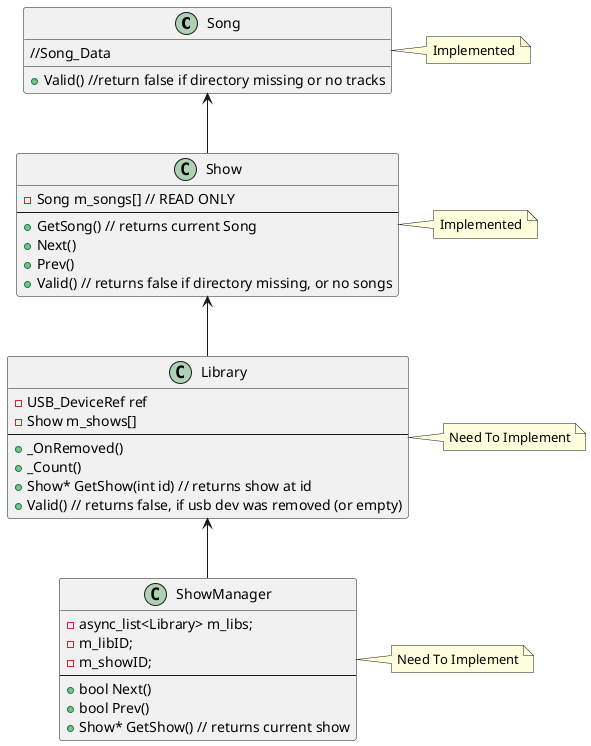
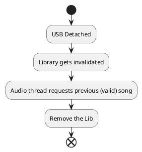
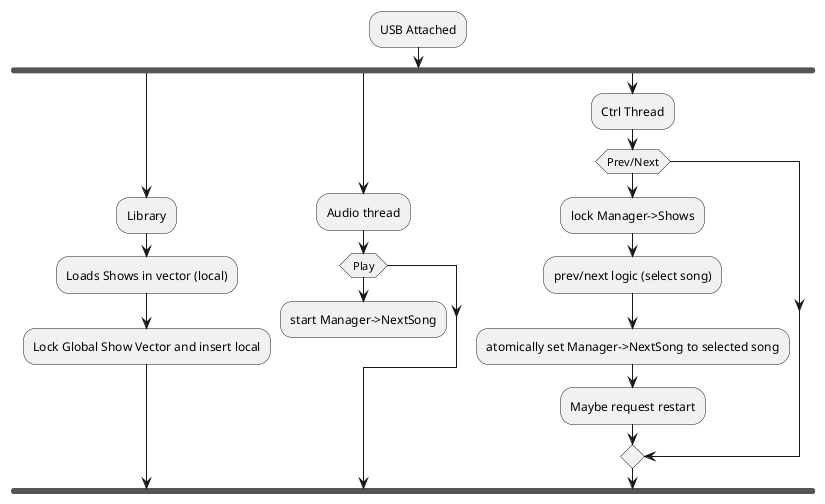

# Backing Track Player
### Features
- N audio files N channel **Input** to **8 channel** *(can also be adjusted in the code)* **output**
- Start/stop, revert
- Song in one show management **TODO**
- multiple show management **TODO**
- auto load shows from usb when inserted **TODO**
- Internally uses f32 for easier programming

### Install
```
git clone https://github.com/MineStorm999/BackingtrackPlayer_BG.git
git checkout RaspiTest
cd "to/cloned/dir"
mkdir build
cd build 
cmake ..
```

the created executable should be in build/bin 
### Roadmap
[TodoList](TODO.md)

### Libraries used
- [Mini Audio](https://github.com/mackron/miniaudio) for wav/mp3/flac file streaming and multichannel playblack
- [JSON](https://github.com/nlohmann/json) for human readable config
- [Eigen](https://libeigen.gitlab.io/) for vectorisation

## Docs
### JSON Config 
***Important*** All paths **must** be *relative*  

**Song Config**
- Shows must contain .song (ie.: my_show.song.json)
```
"name":"song name",
"tracks":[
    {   // per track (file)
        "path":"path/to/audio/file",
        "volume":1.0,
        "routing":[
            [0,1,2,3,4,5,6,7], // route channel 0 to 0-7 out
            [0,1,2,3], // route channel 1 to 0-3 out
        ]
    },
    {   // per track (file)
        "path":"path/to/audio/file2", 
        "volume":1.0,
        "routing":[
            [0,1,2,3,4,5,6,7], // route channel 0 to 0-7 out
            [0,1,2,3], // route channel 1 to 0-3 out
        ]
    }
]
```
**Show Config**
- Shows Must be in top (root) level.
- Shows must contain .show (ie.: my_show.show.json)
```
"name":"show name",
"songs":[
    {
        "path":"path/to/show.config"
    },
    {
        "path":"path/to/show1.config"
    }
]
```
**Folder Structure Example**
```
root/
|-my_show.show.json
|-my_song/
  |---my_song.song.json
  |---track.wav
  |---track1.wav
  |---track2.wav
|-my_song2/
  |---my_song.song.json
  |---Tracks/
      |---track.wav
      |---track1.wav
      |---track2.wav
```

### Show Manager


### What happens when the usb gets detached


### What happens when the usb gets attached

